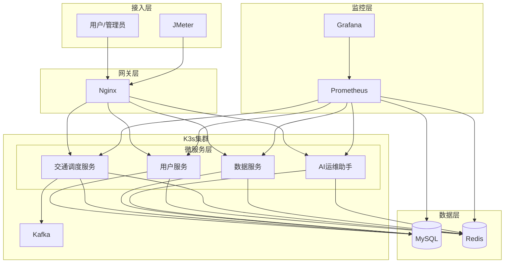

# 基于 K3s 的分布式交通调度系统

三台虚拟机（1 主 2 从）跑 K3s，上面部署一个班次查询服务：输入出发城市、到达城市和策略（最快 / 最省钱 / 最少换乘），后端用 A* 算法在城市与线路图上搜一条路线返回。城市和线路是 MySQL 里的示例数据，不覆盖完整线路库。

## 当前实现范围

- 业务层就是一个 Go 单体 `schedule-service`（2 副本），代码在 `go-service/`
- Redis 哨兵做查询缓存，MySQL 三副本一主两从存城市与线路数据
- Nginx 反代 + 限流，Prometheus 采集节点和 Pod 指标，Grafana 出面板
- Kafka 只写了生产者初始化，业务消息发送还没接入；Spark 预计算任务只交了代码、没有跑；微服务拆分是计划书里的规划，当前没有落地。这些在 `docs/` 计划书里有说明，README 不另外展开。

## 架构（实际部署拓扑）



请求顺序：先查 Redis 哨兵缓存，命中直接返回；未命中从 MySQL 读城市表和线路表，跑完 A* 再把结果写回 Redis。整个查询被 Hystrix 包住，失败时先降级返回旧缓存，再没有缓存才回 503。

## 技术组件

- K3s v1.27.16，CentOS 7，三台 VMware 虚机
- Go + Gin 提供查询接口，A* 三策略寻路，hystrix-go 做熔断降级
- MySQL 8.0.28 三副本一主两从，binlog 复制
- Redis 7.0.15 三副本，每个 Pod 内同时跑 redis 和 sentinel
- Nginx 1.24 反代，`limit_req` 限流 1000r/s、burst 200，超时 10s
- Prometheus v2.45 采集，Alertmanager v0.25，Grafana 10.0 展示
- Kafka 2.12-2.4.1 + Zookeeper 3.5.9 各单副本已部署，生产者连接初始化完成，消息链路未打通

## 怎么跑

镜像为离线构建，先在各节点 `ctr images import` 导入镜像。仓库不带 cities / routes 初始化数据，需要先把示例城市和线路导入 MySQL，再在 master 节点执行：

```bash
kubectl apply -f deploy/namespace.yaml
kubectl apply -f deploy/

kubectl -n schedule-system get pods -o wide    # 等全部 Running

curl http://<node-ip>:30080/health             # 返回 ok 即网关到服务连通

curl -X POST http://<node-ip>:30080/api/v1/route/query \
  -H 'Content-Type: application/json' \
  -d '{"from_city":"BJ","to_city":"SH","strategy":1}'
```

返回结果里 `from` 字段为 `cache` 表示走了 Redis 缓存，`database` 表示本次从数据库算出，`fallback_cache` 是熔断降级返回的旧缓存。

## 目录

```
deploy/           全部 K8s YAML（与线上集群一致）
docs/             计划书、排障记录、演示截图
go-service/       Go 单体服务源码（v5.0，哨兵连接、健康探针、拓扑分布）
scripts/          MySQL / Redis 备份、节点初始化脚本，HDFS 冷备为规划占位
spark-precompute/ Spark 预计算任务（代码已交，未实际运行）
```

## 压测数据

JMeter 5.6.3，2026-10-28，压测前缓存已预热：

| | 100 并发 | 500 并发 | 1000 并发 |
|---|---|---|---|
| 样本数 | 80,428 | 82,334 | 83,995 |
| 平均响应 | 148 ms | 670 ms | 1,258 ms |
| 错误率 | 0.27% | 2.29% | 8.83% |
| 吞吐量 | 669/s | 649/s | 687/s |

整改前错误率分别为 35.03% / 82.60% / 93.98%。当时未命中缓存会全量读 cities 和 routes 两张表，叠加 Hystrix 3 秒超时，高并发下大量请求熔断超时。后来把业务 Pod CPU 限制提到 1 核、Nginx 读写超时调到 10s、压测前先预热缓存，得到上表结果。1000 并发下仍有 8.83% 错误，主要来自 Nginx 限流和服务端排队，不是部署错误。

## 监控

- Grafana：`http://<node-ip>:30300`，仪表盘「K3s 集群监控总览」
- Prometheus：`http://<node-ip>:30090`
- Alertmanager 已部署，钉钉机器人 webhook 地址仍是占位配置，真实告警推送未接入。

## 文档

- [计划书](docs/基于%20K3s%20的分布式交通调度系统计划书.docx)
- [系统说明和排障记录（69 条）](docs/基于K3s的分布式交通调度系统.docx)
- [演示截图](docs/项目截图.pdf)

## License

MIT，见 LICENSE。
